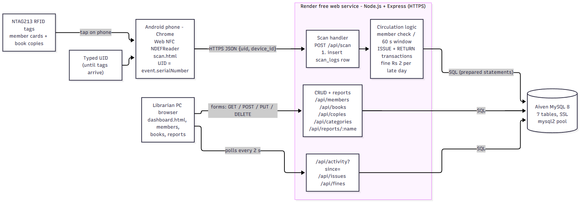
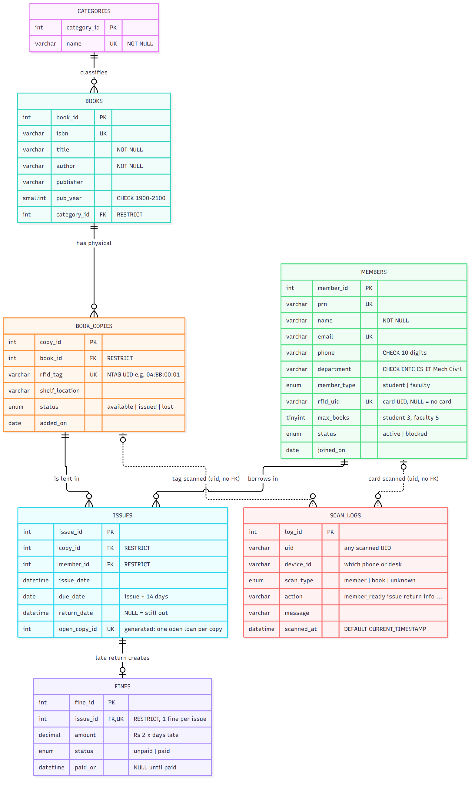

# Library Management System with RFID

DBMS mini project. A college library where **member cards and book copies carry
NTAG213 RFID tags**. An Android phone running Chrome reads a tag with **Web NFC**
and sends its UID to a **Node.js + Express** backend. The backend issues books,
takes returns and charges fines in a **MySQL 8** database hosted on **Aiven**.
Until the tags arrive, every scan also works by typing the UID.

- 7 related tables, PK / FK / UNIQUE / CHECK constraints, a generated column
- full CRUD for members, books, copies, categories
- RFID scan flow with **transactions** (issue / return / fine)
- 3 indexes with EXPLAIN before / after, 7 report queries
- plain HTML pages: scan desk, dashboard (live, polls every 2 s), members, books, reports



---

## Folder structure

```
db/schema.sql        7 tables (drops and re-creates them)
db/seed.sql          sample data (dates relative to today)
db/indexes.sql       3 indexes, each with its reason
db/queries.sql       the 7 report queries (also used by the website)
db/outputs/          explain_before.txt, explain_after.txt, query_results.txt
docs/                er-diagram.png, architecture.png + Mermaid sources (.mmd)
scripts/             test-connection, run-sql, run-indexes, run-queries, test-scan, test-crud
src/server.js        Express app (API + static website)
src/db.js            mysql2 connection pool (SSL, IST time zone)
src/helpers.js       validation, UID format, central error handler
src/reports.js       reads db/queries.sql
src/routes/*.js      categories, books, copies, members, scan, circulation, reports, activity
public/              scan.html, dashboard.html, members.html, books.html, reports.html, style.css, js/
```

## Run locally

Needs Node.js 20+ and an Aiven MySQL service (free plan).

1. `npm install`
2. Copy `.env.example` to `.env` and fill in `DB_HOST`, `DB_PORT`, `DB_USER`, `DB_PASSWORD`
   from Aiven (Service -> Overview -> Connection information). Keep `DB_NAME=library_db`.
3. Download the Aiven **CA certificate** and save it as `ca.pem` in the project folder.
4. Run:

| command | what it does |
|---|---|
| `npm run db:test` | connects over SSL, creates `library_db` if missing, prints version / time zone / cipher |
| `npm run db:setup` | runs `schema.sql` + `seed.sql` (**resets all data**) |
| `npm run db:indexes` | EXPLAIN before -> creates indexes -> EXPLAIN after (run right after db:setup) |
| `npm run db:queries` | runs the 7 queries, saves `db/outputs/query_results.txt` |
| `npm start` | starts the website on http://localhost:3000 |
| `npm run test:scan` | end-to-end RFID flow test against the real DB (25 checks) |
| `npm run test:crud` | smoke test of every API route (65 checks) |
| `TEST_URL=https://lms-rfid.onrender.com npm run test:scan` | run a test suite against the deployed app instead (same DB) |

The two test scripts create their own `TEST` rows and delete them at the end.

> Aiven runs MySQL with `sql_mode = ANSI`: text values must use **'single quotes'**
> (double quotes mean a column name). All SQL in this project follows that.

## Deploy on Render (free)

1. Push this repo to GitHub (`.env` and `ca.pem` are git-ignored, never commit them).
2. Render dashboard -> **New -> Web Service** -> connect the GitHub repo.
3. Language **Node**, Build command `npm install`, Start command `npm start`, Instance type **Free**.
4. Environment variables: `DB_HOST`, `DB_PORT`, `DB_USER`, `DB_PASSWORD`, `DB_NAME=library_db`,
   and `DB_CA` = the whole text of `ca.pem` (from `-----BEGIN CERTIFICATE-----` to
   `-----END CERTIFICATE-----`). The app uses `DB_CA` when it is set, otherwise `./ca.pem`.
   (`PORT` is set by Render automatically.)
5. Deploy, then open `https://<your-app>.onrender.com/api/health` -> `{"ok":true,...}`.

A free Render service sleeps after ~15 minutes without visitors; the first request
after that takes about a minute. Open `/api/health` a minute before a demo.

## Replacing the demo UIDs with real tags

The seed has fake UIDs (`04:AA:00:xx` member cards, `04:BB:00:xx` book tags).
Two members and four copies are marked **DEMO** in `db/seed.sql` for your real tags:

| row | name | demo UID |
|---|---|---|
| member 17 | Riya Naik (student) | 04:AA:00:17 |
| member 18 | Prof. Vikram Bhide (faculty) | 04:AA:00:18 |
| copy 22 | Design of Steel Structures | 04:BB:00:22 |
| copy 23 | Higher Engineering Mathematics | 04:BB:00:23 |
| copy 24 | Advanced Engineering Mathematics | 04:BB:00:24 |
| copy 25 | Engineering Physics | 04:BB:00:25 |

**1. Find a tag's UID.** Open the scan page on the phone, tap *Start NFC scan*, hold the
new tag to the phone. It shows `Unregistered tag 04:5A:3B:...`. Unknown tags are also
saved in scan_logs:

```sql
SELECT uid, scanned_at FROM scan_logs
WHERE action = 'unregistered' ORDER BY log_id DESC LIMIT 6;
```

**2. Store it** (upper-case hex with colons; a CHECK constraint rejects other formats):

```sql
UPDATE members     SET rfid_uid = '04:5A:3B:C2:91:6E:80' WHERE member_id = 17;
UPDATE members     SET rfid_uid = '04:7F:12:AA:03:5D:81' WHERE member_id = 18;
UPDATE book_copies SET rfid_tag = '04:11:22:33:44:55:66' WHERE copy_id = 22;
UPDATE book_copies SET rfid_tag = '04:11:22:33:44:55:67' WHERE copy_id = 23;
UPDATE book_copies SET rfid_tag = '04:11:22:33:44:55:68' WHERE copy_id = 24;
UPDATE book_copies SET rfid_tag = '04:11:22:33:44:55:69' WHERE copy_id = 25;
```

Or use the website: Members -> Edit -> *Card UID*, Books -> Copies -> Edit -> *RFID tag*
(lower case or no colons is fine there; the server converts it).
`npm run db:setup` puts the demo UIDs back, so also edit `db/seed.sql` if you re-seed.

## API

| method + path | purpose |
|---|---|
| `GET/POST /api/members`, `GET/PUT/DELETE /api/members/:id` | members CRUD (`?q=` search) |
| `GET/POST /api/books`, `GET/PUT/DELETE /api/books/:id` | books CRUD (`?q=` search) |
| `GET/POST /api/copies`, `GET/PUT/DELETE /api/copies/:id` | copies CRUD (`?book_id=`) |
| `GET/POST /api/categories`, `GET/PUT/DELETE /api/categories/:id` | categories CRUD |
| `POST /api/scan` `{uid, device_id}` | RFID scan -> `{action, message, member?, book?, due_date?, fine?}` |
| `GET /api/issues?status=open\|overdue\|all` | loans |
| `GET /api/fines?status=unpaid\|paid\|all`, `POST /api/fines/:id/pay` | fines |
| `GET /api/reports`, `GET /api/reports/:name` | the 7 report queries |
| `GET /api/activity?since=<log_id>` | new scans + dashboard counts (polling) |
| `GET /api/health` | server + database check |

Errors always come back as `{ "error": "..." }`, e.g. deleting a member with loan
history gives *409 "This member has loan history, so they cannot be deleted. Block them instead."*

---

# Viva cheat-sheet

Suggested split: **Student 1** schema + ER + constraints, **Student 2** indexes + 7 queries,
**Student 3** scan flow + transactions + API.

## 1. Schema (7 tables)



| table | one row = | key points |
|---|---|---|
| categories | a subject | `name` UNIQUE |
| books | a **title** | `isbn` UNIQUE, FK category |
| book_copies | a **physical copy** with its own RFID tag | `rfid_tag` UNIQUE, `status` ENUM, FK book |
| members | a student / faculty | `prn`, `email`, `rfid_uid` UNIQUE; `max_books` 3 / 5 |
| issues | one **loan** | FK copy + FK member; `return_date NULL` = still out |
| fines | a fine for one late loan | `issue_id` UNIQUE -> at most one fine per loan |
| scan_logs | every scan | **no FK on purpose**: unknown tags must be logged too |

- **Relationships**: category 1-N books, book 1-N copies, copy 1-N issues, member 1-N issues,
  issue 1-0..1 fine. `issues` is the link (associative) table between members and copies.
- **Why books and book_copies are separate**: title, author and ISBN are stored once (no
  repetition for 3 copies). Each copy has its own tag, shelf and status. This is normalisation.
- **3NF**: every column depends only on its table's key. Example: `fines` has no
  `member_id` because the member comes from `issues`. Storing it twice could disagree.
- **ON DELETE RESTRICT**: a member, copy, book or category that has history cannot be
  deleted (history must not vanish). The API turns that MySQL error into a friendly message.
- **CHECK constraints**: phone is 10 digits starting 6-9, department is one of 5, email
  contains @, UID format, pub_year range, `max_books` 1-10, `due_date > issue date`,
  `return_date >= issue_date`, `amount > 0`, paid fine must have `paid_on`.
- **Generated column** `issues.open_copy_id = IF(return_date IS NULL, copy_id, NULL)` with
  UNIQUE: a copy can never have two open loans. UNIQUE allows many NULLs, so old
  returned loans don't clash.
- **Data types**: `DECIMAL(8,2)` for money (exact, no float rounding), `DATETIME` for when
  something happened, `DATE` for the due date, `ENUM` for fixed status values.

## 2. Indexes (db/indexes.sql, proof in db/outputs/)

| index | query it speeds up | EXPLAIN before -> after |
|---|---|---|
| `issues(member_id, return_date)` | books a member holds now (runs on **every** issue) | ref on FK index, 4 rows -> ref on both columns, 2 rows, **"Using index" (covering)** |
| `issues(return_date, due_date)` | overdue report, due-soon list | **ALL** (full scan, 20 rows) -> **range**, 4 rows |
| `scan_logs(device_id, scanned_at)` | 60-second issue window (runs on **every** book scan) | **ALL** 31 rows + filesort -> **range** 1 row, backward index scan, no filesort |
| (already there) UNIQUE `rfid_uid`, `rfid_tag` | tag lookup on every scan | **const**, 1 row: UNIQUE already creates an index |

Why `(return_date, due_date)` and not just `due_date`: every **old returned** loan also
has a due date in the past. So `due_date < today` matches almost the whole table, and
MySQL ignored a plain due_date index (we tried; EXPLAIN still showed ALL). Putting
`return_date` first narrows to books still out, then due_date is a range inside that.

Composite index rule: equality column first, then range / sort column (leftmost prefix).

## 3. The 7 queries (db/queries.sql)

| # | report | SQL ideas to mention |
|---|---|---|
| Q1 | overdue books + member + fine so far | 4-table INNER JOIN, `DATEDIFF`, `IS NULL`, computed column |
| Q2 | top 10 most borrowed titles | JOIN, `GROUP BY`, `COUNT`, `ORDER BY ... DESC`, `LIMIT` |
| Q3 | category-wise issue count | **LEFT JOIN** keeps categories with 0 issues, `COUNT(DISTINCT)` |
| Q4 | a member's current books | parameter `@member_id` (`?` in the API), `CASE WHEN` |
| Q5 | fines collected per month | `WHERE status='paid'`, `DATE_FORMAT`, `GROUP BY` month, `SUM` |
| Q6 | daily footfall (last 7 days) | `COUNT(DISTINCT CASE ...)`, `SUM(condition)` counts true rows |
| Q7 | titles with zero available copies | LEFT JOIN + `GROUP BY` + **HAVING**, `COALESCE` for books with no copies |

WHERE filters rows **before** grouping; HAVING filters groups **after** (Q7).

## 4. Data flow of one scan (src/routes/scan.js)

```
phone (Web NFC: event.serialNumber) or typed UID
  -> POST /api/scan {uid, device_id}
  -> 1. INSERT INTO scan_logs (uid, device_id)       -- always logged first
  -> 2. what is this UID?
       member card   -> rules OK?  member_ready  /  rejected (blocked, unpaid fine, limit)
       copy 'issued' -> RETURN transaction
       copy on shelf -> member_ready on SAME device in last 60 s (from scan_logs)?
                          yes -> ISSUE transaction      no -> INFO (title, shelf, copies)
       not found     -> unregistered
  -> 3. UPDATE scan_logs SET scan_type, action, message   -- result saved on the same row
  -> JSON {action, message, member?, book?, due_date?, fine?}
```

**Borrow rule**: `status = 'active'` AND open loans < `max_books` AND no unpaid fines.

**60-second window** is a query on `scan_logs`, not a variable in server memory, so it
survives a server restart. It uses the latest *member* scan on that device. If that
member was rejected, an earlier "ready" member does not get the book.

**ISSUE transaction**
```sql
START TRANSACTION;
SELECT status FROM book_copies WHERE copy_id = ? FOR UPDATE;   -- lock the copy
SELECT member_id FROM members WHERE member_id = ? FOR UPDATE;  -- lock the member
-- re-check the borrow rule inside the transaction
INSERT INTO issues (copy_id, member_id, issue_date, due_date)
VALUES (?, ?, NOW(), CURDATE() + INTERVAL 14 DAY);
UPDATE book_copies SET status = 'issued' WHERE copy_id = ?;
COMMIT;    -- on any error: ROLLBACK, nothing changes
```

**RETURN transaction**
```sql
START TRANSACTION;
SELECT ... FROM issues WHERE copy_id = ? AND return_date IS NULL FOR UPDATE;
UPDATE issues SET return_date = NOW() WHERE issue_id = ?;
UPDATE book_copies SET status = 'available' WHERE copy_id = ?;
INSERT INTO fines (issue_id, amount)               -- Rs 2 per late day, only if late
SELECT issue_id, DATEDIFF(DATE(return_date), due_date) * 2
FROM issues WHERE issue_id = ? AND DATE(return_date) > due_date;
COMMIT;
```

**ACID in one line each**: *Atomic*, the loan row and copy status change together or not
at all. *Consistent*, constraints (FK, CHECK, UNIQUE open_copy_id) always hold.
*Isolated*, `FOR UPDATE` row locks stop two phones issuing the same copy or passing the
limit at the same time. *Durable*, after COMMIT, InnoDB keeps it even if the server crashes.

## 5. Quick answers

- **Why prepared statements?** Values are sent separately from the SQL, so typed input
  cannot change the query (SQL injection is impossible). Every query uses `?` placeholders.
- **Why a connection pool?** Opening an SSL connection to Aiven is slow. The pool keeps 5
  open and reuses them.
- **Why RESTRICT and not CASCADE?** CASCADE would silently delete loan and fine history.
- **Why is the fine created on return, not daily?** The amount is only final when the book
  comes back. Q1 shows the fine so far for books still out.
- **Where is the time zone set?** `SET time_zone = '+05:30'` on every pool connection, so
  `NOW()` and `CURDATE()` are Indian time.
- **What if the server crashes in the middle of an issue?** The transaction never
  committed, so MySQL rolls it back. The scan_logs row stays as `pending`.
- **How does the dashboard update live?** Every 2 s it calls `/api/activity?since=<last log_id>`
  and only gets scans newer than the last one it has (`log_id > ?`, uses the primary key).
